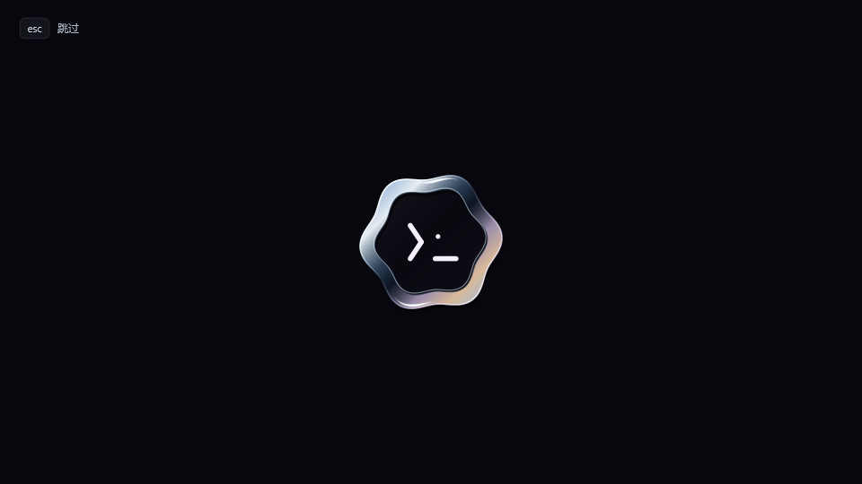

# ChatGPT Liquid Glass 启动动画

为 Windows 桌面版 ChatGPT 添加「welcome liu」连续手写、液态玻璃轮廓与镂空揭幕过场。



## 下载使用

当前版本：**v1.0.1**。完整记录见[更新日志](CHANGELOG.md)。

1. 在右侧 **Releases** 下载 `ChatGPT-Glass-Startup-Windows-x64.zip`。
2. 完整解压，双击 `Install.cmd`。无需管理员权限，无需 Python、Node.js 或动画软件。
3. 安装器自动识别这台电脑上的 ChatGPT；找不到时，选择原来的 ChatGPT 快捷方式或 `.exe`。
4. 以后双击桌面的 **ChatGPT** 图标：从纯黑画面开始，写出 welcome liu，随后连贯变成玻璃图标，并镂空展开真实软件界面。

适用于 **Windows 10/11 64 位**，需已安装桌面版 ChatGPT 和 .NET Framework 4.8。当前不提供 macOS 版本。安装文件位于 `%LOCALAPPDATA%\ChatGPTGlassStartup`；解压目录安装后可删除。

程序尚未进行代码签名，Windows 可能显示发布者未知。

## 动画与操作

- 黑色首帧，约 0.35 秒后开始逐笔书写；文字为 **welcome liu**。
- 手写段比原版加速约 15%，后面的图标和展开节奏保持不变，总长约 7.8 秒。
- 跟随软件窗口的位置和大小，覆盖标题栏、菜单栏；顶部可拖动软件窗口。
- 使用普通窗口层级，切换到其他软件时，其他软件可以覆盖动画。
- 玻璃具有较厚的截面、内外明暗边缘、内容折射和移动镜面反光。
- 左上角显示简洁的 `esc` 键帽和“跳过”；按 **Esc** 立即跳过。纯黑首帧之后提示再淡入，镂空展开时淡出。
- 启动中临时窗口被替换时自动重新绑定，避免动画提前中断。
- 矢量实时渲染，随屏幕刷新更新；不会放大低分辨率图片序列。

效果通过安装器创建的**桌面入口**生效。原任务栏固定入口、开始菜单及系统开机启动项不会自动接入。

更新已有安装：下载新版 ZIP，解压后再次运行 `Install.cmd`，即可替换启动器；原桌面快捷方式备份会保留。

## 卸载恢复

按 `Win+R`，输入 `%LOCALAPPDATA%\ChatGPTGlassStartup`，运行里面的 `Uninstall.cmd`。安装前存在的桌面快捷方式会恢复。若你自行修改了桌面入口，卸载器会保留你的修改。

## 从源码构建

Windows PowerShell 中运行：

```powershell
powershell -NoProfile -ExecutionPolicy Bypass -File .\Build.ps1
```

`src/StartupVector.cs` 是矢量动画与玻璃材质，`src/StartupLauncher.cs` 负责黑屏首帧、软件激活、窗口跟随与生命周期。`startup-paths.json` 保存手写路径。`tools/startup_manim.py` 保留早期 Manim 视频工程，最终启动效果以 WPF 渲染器为准。

回归测试：安装到测试目录后运行 `ChatGPT-Startup.exe --self-test`。测试验证纯黑首帧、首帧先于应用激活、临时窗口更换、窗口移动缩放、其他窗口能覆盖动画和完整播放；不启动真正的 ChatGPT。

## 数据与配色

运行记录与窗口位置只保存在本机安装目录。折射使用的窗口图像仅保存在内存，不保存截图，也没有上传接口。

色彩参考 [Apple WWDC26 官方视觉](https://developer.apple.com/news/?id=q7tgn1rr)，玻璃表现参考 [Apple 的 Liquid Glass 材质说明](https://developer.apple.com/design/human-interface-guidelines/materials)。这是 Windows 上的 Liquid Glass 风格实现。
